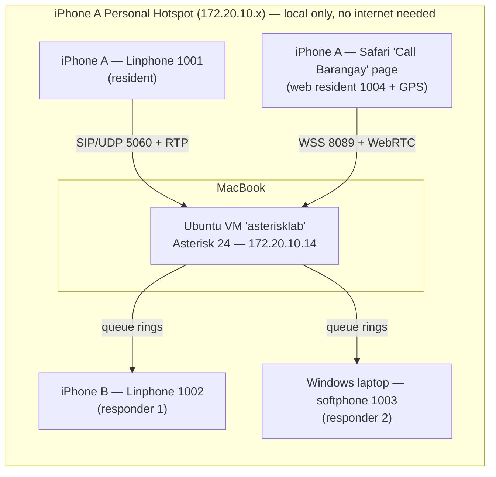

# Testing guide — real devices (2 iPhones, MacBook, Windows laptop)

How to set up every device and run the remaining live tests (Day 4 IVR, Day 5 iPhone web caller,
Day 6 call quality over the hotspot) and the Day 7 demo. Passwords and PINs are **not** in this file:
read them from `/etc/asterisk/pjsip.conf` and `/etc/asterisk/voicemail.conf` on the VM.

---

## 1. How the system works



**What happens when a resident dials 8000:**

1. **Consent notice** (prompt-101): "this call is recorded".
2. **Menu** (prompt-102): **1** Fire · **2** Medical · **3** Peace & order · no key (2 tries) → General.
3. The category is saved to the CDR (`userfield`), the call starts recording (MixMonitor), and the caller hears "connecting you" (prompt-103).
4. The **category queue** rings its responders one at a time, round-robin with memory (`rrmemory`: it starts after whoever got the last call), 15 s each, for up to 60 s:

   | Queue | Rings |
   | --- | --- |
   | q-fire | 1002 |
   | q-medical | 1003, 1002 |
   | q-peace | 1002 |
   | q-general | 1002, 1003 |

5. Nobody answers → prompt-104 → **voicemail** (box 1002), so no call is lost.
6. At hangup, the call-quality handler writes one row to `qos.csv` (jitter, loss, RTT, MES score).

**Web caller (1004) extra steps:** the page reads the phone's GPS and sends it in an `X-Location` SIP header.
Asterisk writes it to `locations.csv` with the call's UNIQUEID, which joins to the CDR and `qos.csv`.
The browser account can **only** dial 8000.

**Where the evidence lands (on the VM):**

| File | One row per | Contains |
| --- | --- | --- |
| `/var/log/asterisk/cdr-csv/Master.csv` | call | caller, start/end, duration, category (`userfield`), UNIQUEID |
| `/var/log/asterisk/queue_log` | queue event | ENTERQUEUE, CONNECT (answered by), ABANDON, … |
| `/var/log/asterisk/locations.csv` | web call | time, UNIQUEID, caller, lat/lon/accuracy |
| `/var/log/asterisk/qos.csv` | hotline call | category, billsec, RTCP stats |
| `/var/spool/asterisk/monitor/` | hotline call | recording `<category>-<date>-<caller>.wav` |
| `/var/spool/asterisk/voicemail/default/1002/` | voicemail | messages left when nobody answered |

---

## 2. Why the hotspot (and not home Wi-Fi or mobile data)

- **Home Wi-Fi:** the router has *client isolation*, so devices reach the internet but **not each other**
  (proven with tcpdump on 13 Nov). If the router has an "AP isolation" setting you can turn it off, and then home Wi-Fi works too.
- **Mobile data between phones:** needs a public IP / relay (TURN). That's out of scope: the lab has no internet-facing services.
- **Hotspot:** all devices join iPhone A's hotspot and form a small LAN. **Calls between them stay on that LAN and use no mobile data.**
  Only internet traffic (app updates, OS updates) uses data, so turn on **Low Data Mode** for the hotspot and pause updates on the laptops.

---

## 3. One-time setup per device

Use the same values everywhere:

| Setting | Value |
| --- | --- |
| SIP server / domain | `172.20.10.14` (check the VM IP first, step 4.2) |
| Transport | **UDP**, port 5060 |
| Media encryption / SRTP | **None** |
| Audio codecs | **PCMU (G.711 µ-law)** and **PCMA (G.711 A-law)** enabled |
| Password | from `/etc/asterisk/pjsip.conf` (`[100X]` auth section) |

### iPhone A — hotspot + resident caller (1001) + web caller (1004)
1. **Settings › Personal Hotspot** → *Allow Others to Join* on. Turn on **Maximize Compatibility** (2.4 GHz; easier for the Mac and Windows laptop).
2. **Settings › Cellular › Cellular Data Options › Data Mode › Low Data Mode** on.
3. **Linphone** → *Use SIP account* → Username `1001`, Password (pjsip.conf), Domain `172.20.10.14`, Transport UDP.
   In Linphone settings: Audio codecs PCMU + PCMA on, Media encryption **None**.
4. **Trust the lab CA** (needed for the web page only):
   AirDrop `/etc/asterisk/keys/ca/rootCA.pem` from the Mac → *Settings › Profile Downloaded* → Install →
   **Settings › General › About › Certificate Trust Settings** → enable the mkcert CA.
   (Don't download it from the web page: Asterisk serves `.crt` as `text/crt` and iOS won't install it.)
5. Allow **Location** and **Microphone** for Safari when the page asks.

### iPhone B — responder 1 (1002)
1. **Settings › Wi-Fi** → join iPhone A's hotspot.
2. **Linphone** → Username `1002`, Password (pjsip.conf), Domain `172.20.10.14`, Transport UDP. Codecs PCMU + PCMA, encryption None.
3. Keep Linphone **open in the foreground** during tests: iOS puts it to sleep and the queue then shows 1002 as `Unavailable`.

### MacBook — server
1. Join iPhone A's hotspot (Wi-Fi menu).
2. **UTM › VM settings › Network** = **Bridged (Advanced)**, interface **en0**. With *Shared Network* the VM gets `192.168.64.x`,
   which the phones can't reach and the TLS certificate doesn't cover.
3. Start the VM. (The Mac can also open the live monitor in Safari; see step 4.4.)

### Windows laptop — responder 2 (1003)
1. Join iPhone A's hotspot. When Windows asks, set the network to **Private** (or *Settings › Network › Wi-Fi › <hotspot> › Network profile type › Private*).
2. Install a free softphone: **Linphone for Windows** (linphone.org) or **MicroSIP** (microsip.org).
   - Linphone: same settings as the iPhones, Username `1003`.
   - MicroSIP: *Add account* → SIP server `172.20.10.14`, Username `1003`, Domain `172.20.10.14`, Password (pjsip.conf), Transport UDP, Media encryption Disabled.
3. When Windows Defender Firewall asks, **Allow** on private networks. Otherwise incoming calls won't ring.
4. Use a headset or the laptop mic/speaker. Keep the app open.

---

## 4. Test day — start-up checklist (do in order)

1. **iPhone A:** hotspot on, screen stays on (Settings › Display › Auto-Lock → Never, during tests).
2. **MacBook:** join the hotspot, start the VM, then on the VM:
   ```bash
   ip -4 addr show enp0s1          # expect 172.20.10.14
   ```
   - If it's a different `172.20.10.x`: use that IP everywhere, and re-run mkcert with the new IP before the web test (certificate SANs).
   - If it's `192.168.64.x`: UTM is not bridged (section 3, MacBook).
3. **Check Asterisk is running and clean:**
   ```bash
   pgrep -a asterisk
   sudo asterisk -rx "core show settings" | grep -i entity   # ea:0f:ea:59:ee:fe
   ```
   If not running: `sudo systemctl stop asterisk && sudo systemctl start asterisk && pgrep -a asterisk`
   (don't trust `systemctl restart`, see CLAUDE.md known issues).
4. **Open the live monitor** on the Mac: `https://172.20.10.14:8089/static/barangay/monitor.html`
   Shows registrations, live calls (step, category, GPS, audio quality), queues and recent calls every 2 s.
5. **Join iPhone B and Windows to the hotspot, open their softphones**, then on the VM:
   ```bash
   sudo asterisk -rx "pjsip show contacts"     # expect 1001, 1002, 1003 = Avail
   sudo asterisk -rx "queue show"              # members should not be Unavailable
   ```
   Not registered → check reachability first: `sudo tcpdump -ni enp0s1 port 5060` while the phone retries.
6. **Record the menu prompt (one time, closes the Day 4 gap):** from iPhone A dial **7102**, wait for the beep, say the menu
   (e.g. "Pindota ang 1 para sa sunog, 2 para sa medikal, 3 para sa kalinaw…"), press **#**. It plays back. Re-dial to redo it.
   Check: `ls -la /var/lib/asterisk/sounds/custom/` shows `prompt-102.wav`.

---

## 5. Test scripts

Before each test, note the time. After it, check the monitor and the evidence files (section 6).

### Test A — basic calls (sanity)
| # | Action | Expected |
| --- | --- | --- |
| A1 | iPhone A dials **600** | echo test: you hear yourself |
| A2 | iPhone A dials **1002** | iPhone B rings; answer, talk both ways |
| A3 | iPhone A dials **1003** | Windows rings; answer, talk both ways |
| A4 | iPhone A dials **1002**, B doesn't answer | after 20 s → voicemail; leave a message |
| A5 | iPhone B dials **\*97** (PIN from voicemail.conf) | hears the message from A4 |

### Test B — hotline IVR (Day 4 live test)
| # | Action | Expected |
| --- | --- | --- |
| B1 | iPhone A dials **8000** | consent notice → menu prompt |
| B2 | press **1** | "connecting" → **iPhone B** rings (q-fire). Answer, talk, hang up |
| B3 | dial 8000, press **2** | Windows (1003) **or** iPhone B rings; if unanswered after 15 s, the other one rings (q-medical) |
| B4 | dial 8000, press **3** | iPhone B rings (q-peace) |
| B5 | dial 8000, press **9** | "invalid", menu repeats |
| B6 | dial 8000, press nothing | menu repeats once, then **q-general** rings B / Windows |
| B7 | dial 8000, press 1, **nobody answers** for 60 s | prompt-104 → voicemail (box 1002) |
| B8 | iPhone B (1002) busy on a call, dial 8000 → 2 | Windows rings (ringinuse=no skips busy 1002) |

### Test C — web caller on iPhone Safari (Day 5)
1. On iPhone A, open `https://172.20.10.14:8089/static/barangay/index.html` (no certificate warning if the CA is trusted).
2. Tap **TAWAG** (Call Barangay). Allow location and microphone.
3. Status goes *Getting location → Connecting → Ringing → Connected*. Tap **1 / 2 / 3** on the page keypad.
4. Expected: the matching responder rings, **audio both ways**, the monitor shows GPS for the call.
5. Hang up with **TAPOS**. Check that `locations.csv` has a row with real GPS (not the self-test `8.228000/124.245000`).

If it connects but there's **no audio:** run `sudo asterisk -rvvv` → `pjsip set logger on`, call again, and look for `.local`
candidates / `a=recvonly` (see test-log.md, Day 5 test 4).

### Test D — call quality over the hotspot (Day 6 phone run)
Same 5 network profiles as the loopback self-test, now on the real hotspot link. On `enp0s1`, netem only delays/drops
**VM → device** packets. Run on the VM, one profile at a time:

```bash
sudo tc qdisc add dev enp0s1 root netem delay 20ms 5ms                                    # lan-good
#   congested: delay 100ms 30ms distribution normal loss 1%
#   poor:      delay 150ms 40ms distribution normal loss 5%
#   bad:       delay 300ms 60ms distribution normal loss 10%
```
1. With a profile active: iPhone A (or Safari) dials 8000 → **2** → Windows/iPhone B answers → talk ~30 s → hang up.
   Note how it sounds (clear / choppy / unusable) and whether the keypress still routed correctly.
2. Remove the profile **before the next one:** `sudo tc qdisc del dev enp0s1 root`
3. Also run one call with **no profile** (baseline).

⚠️ netem on enp0s1 affects *everything* to the VM (also SSH and the monitor). Always run the `del` command when done.

---

## 6. Checking results after each test

```bash
sudo tail -3 /var/log/asterisk/cdr-csv/Master.csv     # call, category, duration
sudo tail -6 /var/log/asterisk/queue_log              # CONNECT = answered (and by whom), ABANDON = hung up waiting
sudo tail -3 /var/log/asterisk/qos.csv                # call quality
sudo tail -3 /var/log/asterisk/locations.csv          # web calls only
ls -la /var/spool/asterisk/monitor/ | tail -5         # recordings (44-byte file = never answered, expected)
```
Join rows across files by the **UNIQUEID** (e.g. `1795078282.0`).

How to read `qos.csv`: `lp` / `rlp` = packets lost by us / by the far end, `rxjitter` and `rtt` are in **seconds**,
`rxmes` / `txmes` = quality score (≈88 excellent, below ≈60 noticeably bad).

Write the results into `docs/test-log.md` (new dated section) and copy CSVs to `docs/evidence/`.

---

## 7. Troubleshooting

| Symptom | Check first |
| --- | --- |
| Phone shows "registration failed / timeout" | Is it on the hotspot? Is the VM IP right? `sudo tcpdump -ni enp0s1 port 5060` shows packets? |
| Registered but queue member `Unavailable` | Linphone asleep on iOS: open the app. Windows: firewall allowed? |
| Responder phone never rings | `queue show` member status; Windows network = Private + firewall allow |
| Call connects, no audio | Linphone codecs PCMU/PCMA on, encryption None; web: see Test C note |
| Menu is silent after consent | `prompt-102.wav` missing: record with **7102** |
| Web page: certificate warning / won't load | CA not trusted on that device, or VM IP not in the certificate (re-run mkcert) |
| Web page: "Connecting…" forever | WSS port 8089 reachable? `ss -ltn \| grep 8089` on the VM |
| Nothing works after Asterisk restart | `pgrep -a asterisk`; restart with stop → start; reload the web page / reopen Linphone |
| Calls end after ~30 s on the web page | `rtp_timeout=30`: browser audio stopped (screen locked / tab in background) |

---

## 8. Day 7 — 5-minute demo flow (suggested)

1. Show the monitor on the Mac: 3 responders + resident registered (30 s).
2. iPhone A Linphone → 8000 → **1 Fire** → iPhone B answers (1 min).
3. iPhone A Safari → **TAWAG** → **2 Medical** → Windows answers; point at the GPS on the monitor (1.5 min).
4. Call 8000 → 3, nobody answers → voicemail; iPhone B plays it with *97 (1 min).
5. Show the evidence: CDR row with category, recording, `locations.csv`, `qos.csv`, joined by UNIQUEID (1 min).
